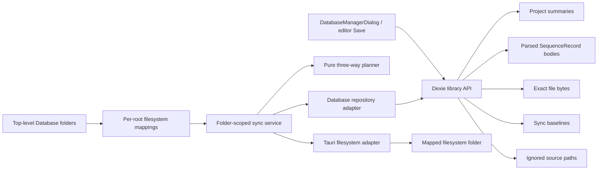

# Database architecture

This document describes the current database-related parts of VibeGene: the IndexedDB schema, file representation, folder mappings, import/export paths, folder-scoped synchronization, save behavior, and Database UI.

## Architectural overview

VibeGene's Database is a local library built on Dexie/IndexedDB. It is not a direct view of an operating-system folder.

The main boundaries are:

- `src/storage/projects.ts`: Dexie schema and project/file persistence.
- `src/storage/projectLibrary.ts`: folder tree operations and source mapping lifecycle.
- `src/storage/databaseSync.ts`: pure synchronization planning.
- `src/storage/folderScopedSyncService.ts`: preflight and apply orchestration.
- `src/storage/folderScopedSyncRepository.ts`: adapts database records to the sync service.
- `src/desktop/folderScopedSyncIo.ts`: reads and writes mapped filesystem folders.
- `src/DatabaseManagerDialog.tsx`: Database browsing, source controls, preflight, and conflict UI.
- `src/App.tsx`: editor-side Save to Database behavior.

## IndexedDB database

The Dexie database is named `vibegene`. Its current schema version is 10.

### Core sequence tables

`projects`

- Contains lightweight `StoredProjectSummary` rows used by Database browsing.
- Stores the project id, construct name, folder, tags, sequence length, topology, and update timestamp.
- Stores file metadata: `fileName`, `fileFormat`, `fileSyncState`, and `fileProvenance`.
- Retains compatibility fields `syncSourceHash` and `syncRelativePath`.
- Does not contain the full sequence body or exact source bytes.

`projectRecords`

- Contains one `StoredProjectRecordRow` per project.
- Stores the normalized editable `SequenceRecord`.
- Is loaded when a construct is opened, exported, or synchronized.

`projectFileBlobs`

- Contains the exact retained file bytes for a project.
- Stores the basename, normalized format, byte length, optional SHA-256 hash, and update timestamp.
- Allows unchanged imported files to be exported or written back byte-for-byte.
- Exact bytes are used only while they still correspond to the current semantic record and baseline.

`projectFileBaselines`

- Contains the last common Database/filesystem state.
- Stores the exact-byte hash, semantic-record hash, source-relative path, filename, format, and capture time.
- Is the base of three-way synchronization.
- Prevents timestamps from being treated as authoritative change evidence.

`projectFileTombstones`

- Represents source-relative paths intentionally removed or moved in the Database.
- Is scoped by top-level Database folder id and relative path.
- Prevents a still-present filesystem file from being immediately re-imported.
- Does not delete the corresponding filesystem file.
- Can be removed through the Database UI's Restore action.

### Folder and mapping tables

`folders`

- Stores `StoredFolder` rows with `id`, `name`, `parentId`, and `updatedAt`.
- A `null` parent identifies a top-level Database folder.
- Nested folders inherit synchronization ownership from their top-level ancestor.

`folderSyncMappings`

- Stores one optional `StoredFolderSyncMapping` per top-level folder.
- Contains the selected absolute filesystem path and local synchronization timestamps.
- Is machine-local state.
- Is not included as an active absolute path in Database exports.
- Nested folders cannot own mappings.

### Primer and application-support tables

The same Dexie database also contains:

- `folderPrimerLists`: primer lists imported from tab-separated `.txt` files and associated with Database folders.
- `commonPrimers`: user-managed common primers.
- `primerLibraryTags`: tags attached to primer identities.
- `proteinProjectIndex`: cached translated CDS peptides per construct (`projectId`, `recordUpdatedAt`, `hits`). Refreshed on save/import/sync; removed on delete. Database Protein mode reads this table and only backfills missing rows.
- `openTabs`: cross-tab workspace state.
- `sharedFragments`: fragments shared between tabs.
- `handoffs`: one-shot records used when opening a construct in another tab/window.

### Schema migration

Version 5 split legacy project rows into lightweight summaries and full record bodies.

Version 9 added:

- filename, format, sync state, and provenance to summaries;
- exact-byte blobs;
- common sync baselines;
- path tombstones;
- per-top-level-folder mappings.

Version 10 added `proteinProjectIndex` for Database Protein mode.

The version 9 migration backfills metadata only. It does not fabricate “original” bytes for legacy rows. Legacy rows without a remembered source filename receive a safe `.dna` filename and remain local-only until synchronized or explicitly saved.

## File model

A Database sequence is represented by several coordinated values rather than by a single object:

- `SequenceRecord`: editable semantic content used by the editor.
- `fileName`: actual basename including extension.
- `fileFormat`: normalized format family.
- exact bytes: retained source or last-written payload.
- baseline disk hash: hash of exact bytes at the last accepted common state.
- baseline semantic hash: hash of the parsed record at the same state.
- relative path: location inside a mapped top-level folder.
- sync state and provenance.

### Sync states

`local-only`

- Has not yet been accepted at the current mapped source.
- Is never removed by inbound cleanup.
- Is written as a new file by outbound sync.

`synced`

- Has a complete byte and semantic baseline shared with the mapped source.

`modified`

- The Database record has changed since the last common baseline.

`conflict`

- Requires explicit review before the relevant sync operation can proceed.

### Provenance

`created`

- Created by VibeGene, normally as a `.dna` project.

`imported`

- Imported into the Database but not currently tied to a source mapping.

`sync-folder`

- Came from, or has been accepted by, a mapped source folder.

`legacy`

- Predates the file metadata model and was normalized during migration.

## Format registry

`src/domain/fileFormats.ts` is the central registry for file capabilities.

It defines:

- normalized format and family names;
- recognized extensions;
- human-readable labels;
- read and write capability;
- serializers for writable formats.

Current format families:

- SnapGene `.dna`: readable and writable.
- GenBank family, including `.gb`, `.gbk`, `.ape`, and `.flat`: readable and writable through the GenBank serializer.
- FASTA family: readable and writable.
- VibeGene JSON: readable and writable.
- Plain `.seq` and `.txt`: readable and writable as sequence text.
- EMBL family: readable, but native overwrite is disabled because there is no safe EMBL writer.
- Unknown formats: neither readable nor writable through the sequence-file registry.

`serializeProjectFile()` is the format-aware serialization entry point. Folder sync uses the target path extension to choose the output format.

## Folder ownership and mappings

A top-level Database folder is the synchronization boundary.

`resolveTopLevelFolder()` finds the owner of any nested folder.

`resolveFolderSyncMapping()` returns the inherited mapping for a nested folder.

`setTopLevelFolderSyncMapping()` creates or changes a mapping:

- first-time mapping leaves local-only files ready for outbound creation;
- changing an existing source detaches source-specific paths and baselines;
- exact blobs are retained;
- old external files are never deleted;
- old root tombstones are cleared because they belonged to the previous source.

Moving or renaming Database folders/projects is handled as a Database-side path change:

- the old mapped relative path is tombstoned;
- the project is detached from its old baseline;
- exact bytes are retained;
- the new Database path becomes local-only and is created by the next outbound sync;
- no filesystem path is deleted.

A mapped top-level folder cannot be nested beneath another folder without first removing its mapping.

## Managed app-data mirror

Desktop builds have a managed mirror in Tauri AppData:

`database-folders/<folder-id>/...`

The adapter is `src/desktop/managedDatabaseFolders.ts`.

It:

- validates folder ids and relative paths;
- blocks absolute paths and `..` traversal;
- reads, writes, and removes managed files through Tauri's AppData base directory;
- returns without filesystem work in the web build.

IndexedDB remains the metadata/index authority. The managed mirror is used for unsourced/local files; it is not a substitute for an explicitly mapped user folder.

## Import paths

### Single-file import

`src/storage/importToLibrary.ts` and `importBytesIntoLibrary()`:

- parse a supported file into a fresh `SequenceRecord`;
- retain the exact input bytes;
- record the real filename and format;
- save it as local-only when no source-relative path is supplied.

### Folder import

`importFolderTreeFromVirtualFs()`:

- creates a new top-level Database folder;
- recreates nested directories as Database folders;
- imports supported sequence files with exact bytes and paths;
- imports recognized tab-separated primer lists into `folderPrimerLists`.

On desktop, `importFolderLibrary()` then maps the new top-level Database folder to the imported operating-system folder.

Current caveat: the mapping setter treats the first mapping as a source change, detaches the imported projects, and removes those initial baselines. As a result, a newly imported desktop folder can enter the mapped state as local-only and encounter path-collision conflicts on its first sync. The mapping call and baseline acceptance should eventually be made one atomic import operation.

### Database import

`importDatabaseFromVirtualFs()`:

- reads `vibegene-database.json`;
- recreates the exported folder hierarchy with new local ids;
- imports exact sequence-file payloads and metadata;
- does not activate machine-specific source mappings.

The manifest parser accepts the VibeGene export format marker and a numeric version. The current writer emits version 2.

## Database export

`buildDatabaseExportBundle()` produces:

- the Database folder tree;
- one sequence file per project;
- `vibegene-database.json`.

Export manifest version 2 includes:

- construct and file names;
- normalized format;
- relative path;
- optional byte and semantic hashes;
- folder, tag, topology, length, and custom ladder metadata.

Export never includes an active absolute source path and does not change any folder mapping.

When the stored exact bytes match both the byte baseline and current semantic-record hash, export writes those exact bytes. Otherwise it serializes the current record in the file's selected format.

## Folder-scoped synchronization

Synchronization is split into four layers.

### 1. Pure planner

`planFolderScopedSync()` in `src/storage/databaseSync.ts` has no filesystem or IndexedDB side effects.

Inputs:

- direction: `from` or `to`;
- Database files and their current semantic hashes;
- scanned disk paths and exact-byte hashes;
- tombstones;
- optional cleanup flag for inbound sync.

Outputs are deterministic actions:

- `addToDb`
- `updateDb`
- `createOnDisk`
- `overwriteDisk`
- `removeFromDb`
- `ignore`
- `conflict`

Matching order:

1. Validate and normalize relative paths.
2. Match case-insensitive relative path identity.
3. Detect path collisions.
4. Attempt only unique exact-baseline-hash rename matching.
5. Classify remaining files.

The current planner does not use mtime, filename stems, or fuzzy matching.

Direction is enforced:

- inbound sync never writes filesystem files;
- outbound sync never adds or updates Database rows;
- cleanup is valid only for inbound sync.

### 2. Service

`createFolderScopedSyncService()` separates preflight from apply.

Preflight:

- loads one mapped top-level scope;
- scans and hashes supported sequence files and recognized tab-separated primer lists;
- produces a deterministic plan;
- returns conflicts without mutation.

Apply:

- re-reads and re-hashes inbound files to detect changes after preflight;
- applies only actions valid for the preflight direction;
- verifies conflict choices;
- records failures per action;
- advances the mapping's successful-sync time only when there are no failures or unresolved conflicts.

Interactive conflict choices currently exposed by the service are:

- Database version for outbound conflicts;
- filesystem version for inbound conflicts.

Path collisions and invalid paths require manual repair. `chooseFolderSyncKeepBothPath()` exists as a deterministic naming helper, but “keep both” is not currently an interactive service choice.

### 3. Repository adapter

`src/storage/folderScopedSyncRepository.ts` connects the service to IndexedDB.

It:

- loads only projects within the selected top-level subtree;
- calculates semantic record hashes;
- supplies retained exact bytes and baselines;
- creates missing nested Database folders for inbound paths;
- imports or replaces Database records;
- serializes Database records for outbound writes;
- commits exact bytes and new baselines after verified writes;
- uses cleanup deletion that does not create user-deletion tombstones;
- imports recognized tab-separated primer lists into `folderPrimerLists` on inbound sync.

### 4. Desktop filesystem adapter

`src/desktop/folderScopedSyncIo.ts`:

- recursively scans only supported sequence files;
- also reads `.txt` files and keeps those that are strict `name<tab>sequence` primer lists;
- excludes dotfiles, `.keep`, arbitrary `.json` (including `vibegene-database.json` and AlphaFold `info.json`), and non-primer `.txt` notes;
- hashes exact bytes;
- validates relative paths;
- writes through a temporary sibling file;
- verifies the temporary payload;
- renames it to the destination;
- reads and verifies the final payload.

No sync path removes a user filesystem file.

## Folder modes

### Linked folders

Only **Import folder** creates a persistent link. Its imported top-level Database folder and source directory form a bidirectional mirror:

- a disk-only addition or edit is imported into the corresponding Database record;
- a Database-only addition or edit is written to the corresponding disk path;
- a disk deletion creates a restorable Database tombstone instead of destroying the record;
- restoring that tombstone writes the record back to its linked directory;
- when both sides changed, VibeGene asks on file close whether to overwrite the disk copy or retain a dated `VibeGene's conflicted copy …` in both places.

The last visible window closing triggers a silent background reconciliation of every linked folder. It never holds a window open or displays a conflict dialog; the macOS process remains available from the Dock until the user explicitly quits. **Sync and clean up** inside a linked folder runs this same reconciliation immediately.

### One-off operations

The three toolbar operations choose a directory for that operation and never create a link:

- **Sync from folder** imports the chosen directory into the selected Database folder.
- **Sync to folder** writes the selected Database folder to the chosen directory.
- **Sync and clean up** performs a reviewed one-time bidirectional reconciliation of the selected Database folder and chosen directory.

Only the one-time cleanup flow presents its preflight/conflict resolver. It never deletes a filesystem file.

## Deletion semantics

User deletion from the Database:

- deletes the Database project, record body, exact blob, and baseline;
- creates a tombstone first when the project belonged to a mapped source;
- leaves the source file untouched;
- prevents later inbound sync from restoring it automatically.

Restore ignored file:

- removes the tombstone;
- does not import immediately;
- makes the source path eligible for the next inbound sync.

Cleanup deletion:

- deletes only Database state;
- does not create a tombstone;
- leaves the already-missing filesystem path alone.

## Editor Save behavior

Editor Save is implemented in `src/App.tsx`, with pure decisions in `src/domain/projectSaveSemantics.ts`.

For an existing `.dna` Database project:

- Save updates the same Database project and exact SnapGene bytes.

For an existing non-SnapGene Database project:

- the dialog defaults to creating a new `.dna` copy in the same Database folder;
- the copy gets a fresh project id and deterministic case-insensitive filename;
- the original Database project and native source file are unchanged;
- native overwrite is a secondary action and is available only when the registry has a safe writer;
- native overwrite updates Database bytes/state but does not immediately write the mapped source; outbound sync performs that write after conflict checking.

For a standalone document:

- the user first chooses a Database folder;
- it is saved as a local-only `.dna` project.

The close-with-unsaved-changes flow routes “Save to database” through the same behavior.

## Database UI

`src/DatabaseManagerDialog.tsx` is shared by the modal and hybrid Database window.

The file table displays:

- full filename with extension;
- construct name when it differs;
- Format;
- Database folder;
- tags;
- updated time;
- sequence size;
- actions.

When a Database folder is selected:

- Import folder is the only action that creates the persistent linked-folder status;
- Sync from and Sync to always choose a one-off directory;
- Sync and clean up uses the linked directory when the selected folder is linked, otherwise chooses a one-off directory;
- one-off cleanup opens a preflight/conflict dialog before mutation;
- linked-folder deletions can be inspected and restored.

Column order and widths are stored in localStorage by `src/storage/databaseUiPrefs.ts`.

## Sync on exit

`src/desktop/syncOnExit.ts`:

- runs only in Tauri;
- starts after the last visible VibeGene window closes;
- reconciles every linked folder in the background;
- does not block, reject, or reopen a window close;
- does not use the one-off conflict resolver;
- leaves the application process alive until explicit Quit.

## Legacy compatibility code

The repository still contains the older global-target and mtime/stem-based sync functions:

- `src/storage/databaseSyncPrefs.ts`
- legacy planners in the lower half of `src/storage/databaseSync.ts`
- `syncFolderTreeIntoDatabase()` in `src/storage/databaseImport.ts`
- development diagnostics in `src/storage/dumpInboundSyncPlan.ts`

The current Database UI and desktop wrappers use the folder-scoped service. New work should use:

- `preflightFolderScopedSync()`
- `applyFolderScopedSync()`
- per-root `folderSyncMappings`
- byte and semantic baselines.

## Tests

The main database/sync test files are:

- `tests/databaseSync.test.ts`: legacy and shared path helpers.
- `tests/folderScopedSync.test.ts`: pure planner action matrix and direction rules.
- `tests/folderScopedSyncService.test.ts`: preflight/apply and conflict handling.
- `tests/folderScopedSyncRepository.test.ts`: exact-byte and repository behavior.
- `tests/folderScopedSyncWrappers.test.ts`: desktop direction wrappers.
- `tests/projectFileMetadata.test.ts`: migration/default metadata.
- `tests/projectLibrary.test.ts`: folder mapping and move/rename invariants.
- `tests/managedDatabaseFolders.test.ts`: app-data path safety.
- `tests/databaseImportMapping.test.ts`: imported folder mapping behavior.
- `tests/databaseExportSideEffects.test.ts`: export mapping isolation and exact bytes.
- `tests/projectSaveSemantics.test.ts`: `.dna` copy and native overwrite decisions.
- `tests/databaseUiPrefs.test.ts`: Format column preference migration.

## Invariants for future changes

- Never infer a top-level mapping from a folder basename.
- Never let Database export change synchronization state.
- Never delete user filesystem files from Database operations or sync.
- Never use mtime as proof that one side should win.
- Never advance a baseline before the corresponding read/write is verified.
- Never remove a local-only Database file during inbound cleanup.
- Never re-import a tombstoned source path.
- Never reuse exact bytes after the semantic record diverges from their baseline.
- Never allow nested folders to own independent source mappings.
- Keep inbound and outbound sync directionally isolated.
